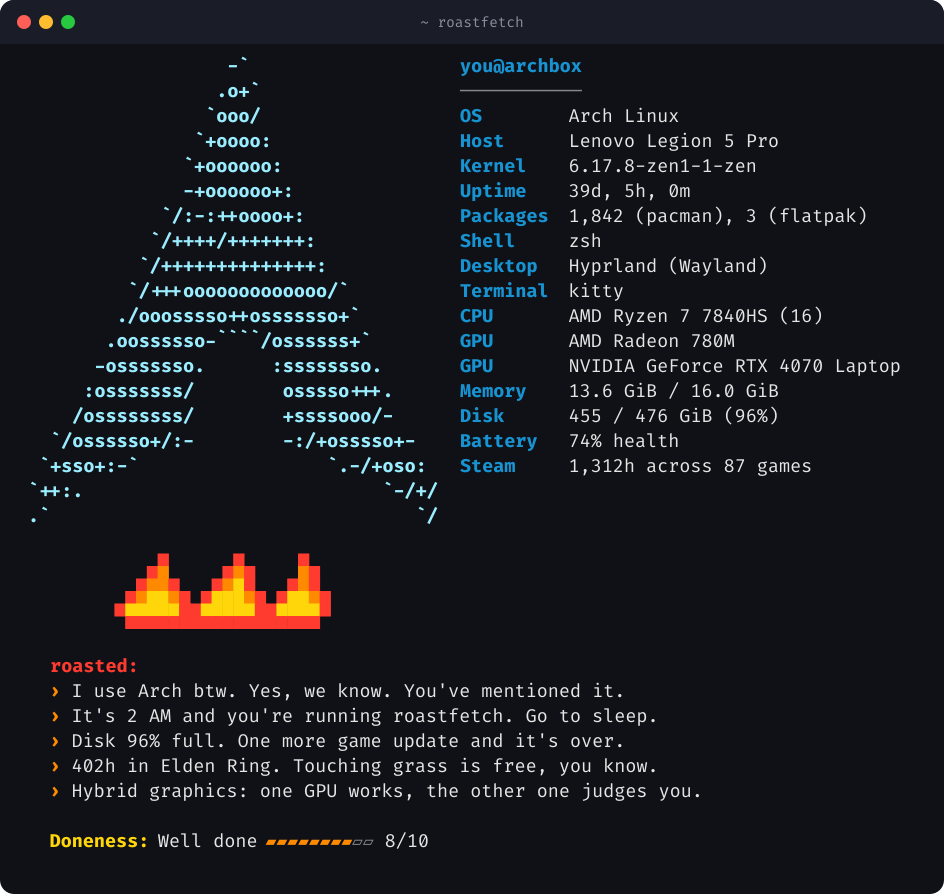

# roastfetch

**A system fetch that roasts you.** Like neofetch or fastfetch, but after the specs it tells you what it really thinks.

```bash
curl -fsSL https://raw.githubusercontent.com/ethembeldagli/roastfetch/main/install.sh | sh
roastfetch
```

<p align="center"></p>

Every run picks different jokes, so run it again until you get the one worth posting.

## Your logo, on fire

roastfetch shows **the same distro logo as your fastfetch or neofetch** (it asks them to draw it, so it matches
exactly), with a little campfire underneath. No fetch tool installed? It draws its own pixel-art logo instead.
Inside a distrobox or toolbox, it shows your host's logo.

## What gets roasted

- **Your distro** (Arch, Ubuntu, Fedora, Bazzite, NixOS, Gentoo, Mint, Kali, … and a fallback for the obscure ones)
- **Your hardware**: NVIDIA, hybrid graphics, gaming laptops, handhelds (Steam Deck, ROG Ally, Xbox Ally, Legion Go, Claw), MacBooks, ThinkPads
- **Your desktop, shell, terminal and $EDITOR**: GNOME, Plasma, Hyprland, oh-my-zsh, kitty, Ghostty, vim…
- **Your habits**: sudo count, typos like `gti`, how often you `clear`, your most-used command
- **Your system state**: uptime, full disk, RAM usage, Flatpak count, custom kernels, battery health
- **Your Steam library**: hours sunk into your most-played game
- **The time**: running it at 2 AM is noted

It finishes with a **doneness** rating, from *Rare* to *Charcoal*.

## Options

```
roastfetch               fetch + 5 roasts
roastfetch -n 8          more roasts
roastfetch --no-roast    just the fetch, no feelings hurt
roastfetch --demo        roast a made-up system instead of yours
roastfetch --seed 42     the same roasts every time
roastfetch --logo arch   borrow another distro's logo (any name fastfetch knows)
roastfetch --pixel-logo  roastfetch's own pixel-art logo
roastfetch --no-logo     hide the logo
roastfetch --json        show what it found
```

Want a fresh roast in every new terminal? Add `roastfetch` to the end of your `~/.bashrc`, `~/.zshrc` or `config.fish`.
It usually runs in under 100 ms.

## Privacy

Everything is read locally from files like `/proc`, `/etc/os-release` and your shell history. Nothing is sent anywhere,
and full command lines are never printed, only command names and counts. One file, plain Python 3.9+, no dependencies.

## Add a roast for your distro

Your distro deserves better (worse) material? Roasts live in plain lists near the top of the
[`roastfetch`](roastfetch) script: `DISTRO_ROASTS`, `DESKTOP_ROASTS`, `TERMINAL_ROASTS`, `HANDHELDS` and friends.
Add a line, keep it under 90 characters, keep it playful (roast the setup, not the person), and open a pull request.

## Also by me

[**Terminal Wrapped**](https://github.com/ethembeldagli/termwrapped): Spotify Wrapped for your Linux terminal.

## License

MIT
